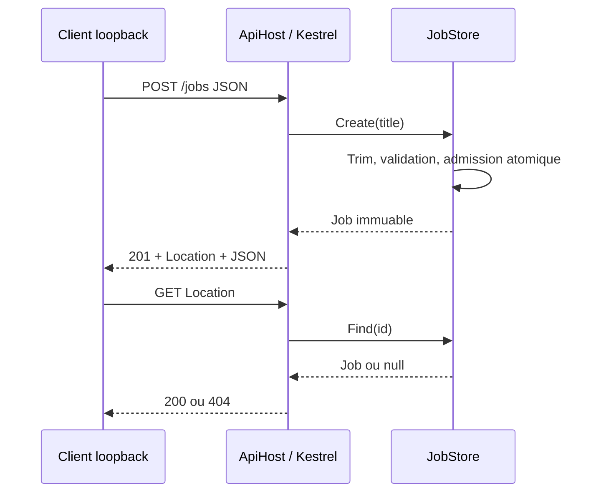

# API modulaire et infrastructure fermée par défaut

## Objectif, exercice et prérequis

Construire une API de travaux techniques synthétiques : POST crée une tâche et GET la relit. Séparer règles métier, contrats et transport HTTP. Décrire ensuite un compte Azure Storage fermé par défaut, sans le déployer. Ce premier socle rattrape l'absence d'implémentation antérieure ; aucune étape précédente n'est prétendue livrée.

Prérequis : SDK .NET 10.0.402, PowerShell pour les exemples ; Azure CLI/Bicep seulement pour compiler l'infrastructure. Aucun package NuGet tiers. La politique officielle consultée le 31/10/2026 classe .NET 10 en LTS. Le runtime local est 10.0.13 alors que la source annonce 10.0.14 : mettre à jour avant toute exposition. Le prototype est strictement local, sans données client.

Critères : titre normalisé, taille limitée, erreurs explicites, 201 avec Location, lecture 200/404, capacité atomique de 1000 tâches. L'infrastructure doit interdire HTTP, clés partagées, blobs anonymes et réseau public. Ne pas contourner les restrictions par un secret.

## Solution complète et lancement

Tout le code est dans `labs/modular-jobs/Api` et `Checks`, le modèle dans `infra/storage.bicep`. Le projet de vérification référence le projet API et le framework ASP.NET ; aucune bibliothèque de test externe n'est nécessaire. Une assertion invalide termine le processus avec un code non nul.

```powershell
dotnet run --project labs/modular-jobs/Checks -c Release
dotnet run --project labs/modular-jobs/Api -- --urls http://127.0.0.1:5080
```

Dans un second terminal :

```powershell
$job = Invoke-RestMethod http://127.0.0.1:5080/jobs -Method Post -ContentType application/json -Body '{"title":"Diagnostic synthétique"}'
Invoke-RestMethod "http://127.0.0.1:5080/jobs/$($job.id)"
```

Attendu : objet avec id GUID, title normalisé et status pending. Ctrl+C arrête le serveur ; redémarrer efface les données.



ASP.NET désérialise l'entrée ; le module valide ; le serveur fixe GUID et statut. Le verrou rend atomiques contrôle de capacité et ajout. Le dictionnaire concurrent permet la lecture sûre d'objets immuables. Le transport transforme les exceptions métier prévues en Problem Details ; le binding traite JSON/média/taille. La santé prouve seulement la réponse du processus.

## Contrat HTTP

JSON UTF-8, propriétés camelCase, pas d'authentification.

| Requête | Résultat |
|---|---|
| GET /health | 200, status ok |
| POST /jobs avec title | 201, objet id/title/status et Location |
| GET /jobs/{guid} | 200 ou 404 |
| Titre absent/null/vide après trim ou >120 unités UTF-16 | 400 Problem Details |
| JSON malformé | 400 |
| Média texte | 415 |
| Corps >4096 octets | 413 |
| Capacité de 1000 atteinte | 503 |
| Identifiant non GUID | 404 de routage |

Chaque POST valide crée un nouvel objet : les retries peuvent dupliquer une tâche. Aucun statut modifiable, liste, suppression, pagination ou isolation utilisateur. Les unités UTF-16 ne sont pas des graphèmes.

## Tests et résultats réellement observés

`dotnet run --project labs/modular-jobs/Checks -c Release --no-restore` : **SUCCESS: 16 checks**, le 31/10/2026 avec SDK 10.0.402 et runtime 10.0.13. Les tests métier couvrent normalisation, quatre entrées invalides et capacité : 1100 admissions concurrentes doivent produire exactement 1000 succès. Les tests HTTP lancent Kestrel sur un port loopback alloué et utilisent HttpClient : santé, création 201, lecture suivant Location, absence, route invalide, validation, JSON malformé, média et taille. Une nouvelle instance vérifie l'absence de persistance. C'est un parcours API réel, pas un test navigateur.

Première tentative : SocketException 10013 du bac à sable sur la connexion locale. Réexécution autorisée sur loopback : succès. Aucun test cloud, authentification, charge soutenue, DB, restauration ou Kubernetes. La CI exécute les mêmes assertions et compile Bicep ; aucun déploiement.

## Architecture, DB et alternatives

Un processus contient les routes `ApiHost`, les contrats immuables et le module `JobStore`. Voir ADR 001. La mémoire permet de prouver les frontières sans dépendance externe. Il n'existe ni DB ni migration ; ne pas annoncer de restauration. PostgreSQL devient préférable pour persistance, transactions et réplication : prévoir table jobs, PK uuid, contrainte titre et migration versionnée. SQLite simplifie une persistance locale mais implique sauvegarde de fichier et limites de concurrence. Blob stocke des objets, sans remplacer une DB transactionnelle.

Les microservices permettraient déploiements indépendants mais ajouteraient timeouts, authentification réseau, cohérence et exploitation sans besoin mesuré ici. Kubernetes sera un lab local distinct ; aucune preuve de cluster n'existe. Avant hébergement, comparer Container Apps et AKS selon besoins réels. Le stockage Azure fourni n'est pas connecté à l'API et ne constitue pas une sauvegarde.

## Sécurité, exploitation et rollback

Écoute loopback obligatoire, données synthétiques uniquement : aucune authentification ni isolation utilisateur. Ne pas exposer à Internet. La capacité est bornée mais ne remplace pas une limitation de débit. Les logs ASP.NET aident au diagnostic ; éviter d'ajouter titres et secrets. Pas d'audit complet de vulnérabilités ni de traçage distribué. Les actions CI utilisent des tags majeurs : épinglage à des SHA vérifiés reste un durcissement à effectuer.

Retour arrière de code : nouveau checkout d'un SHA antérieur validé, tests puis lancement. Cela ne restaure aucune donnée. Arrêter/repartir perd toutes les tâches. Plusieurs réplicas seraient incohérents car chacun aurait son dictionnaire. Ni image Docker ni backup n'ont été produits.

## Questions corrigées

1. Pourquoi un autre réplica répondrait-il 404 après un POST réussi ? Son dictionnaire est distinct ; il faut une persistance partagée avant réplication.
2. Un compte Storage fermé est-il accessible depuis le poste ? Non : il manque connectivité privée et rôle de données. Contributor sur le plan de contrôle ne donne pas automatiquement la lecture des blobs.
3. Une CI verte prouve-t-elle Azure ? Non, seulement les commandes exécutées sur ce SHA. Ni déploiement ni restauration ne sont attestés.

Suite : DB persistante, migration initiale et restauration testée avant réplication ; ce travail n'est pas encore réalisé.

## Sources officielles consultées le 31/10/2026

- https://dotnet.microsoft.com/en-us/platform/support/policy/dotnet-core
- https://learn.microsoft.com/en-us/azure/templates/microsoft.storage/2023-05-01/storageaccounts
- https://learn.microsoft.com/en-us/azure/azure-resource-manager/bicep/deploy-what-if
- https://azure.microsoft.com/en-us/pricing/details/storage/blobs/
- https://learn.microsoft.com/en-us/azure/storage/common/storage-plan-manage-costs

Aucune conclusion réglementaire : les tests d'un prototype local ne démontrent pas une conformité de production.
